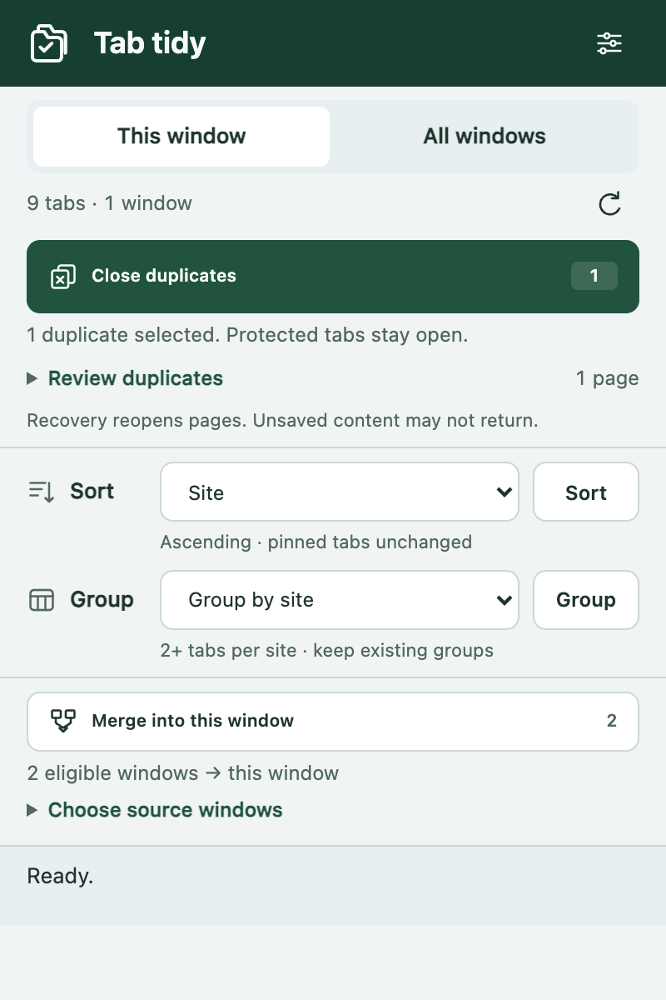
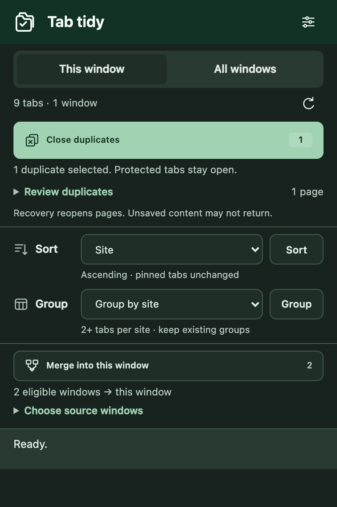
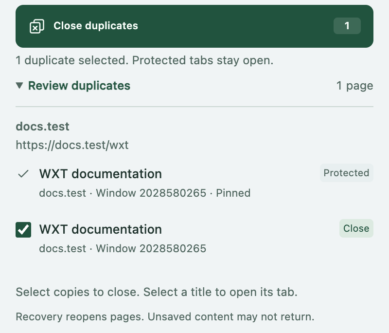
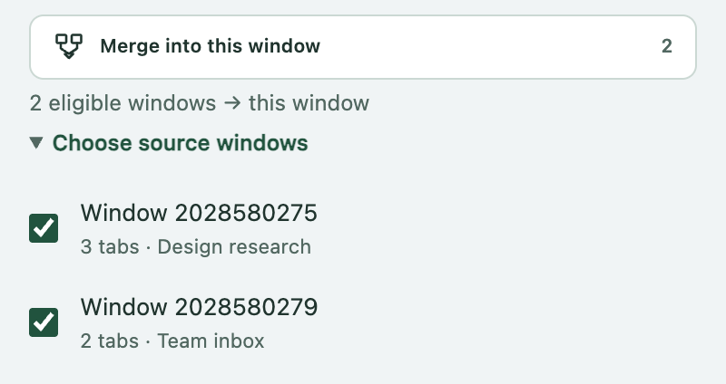
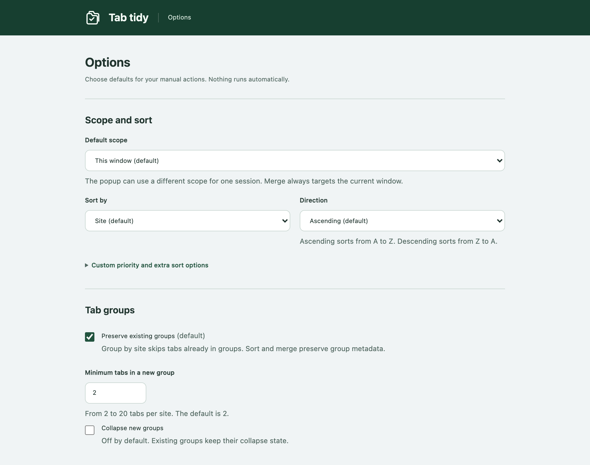

<p align="center">
  
</p>

<p align="center">
  <a href="#screenshots">Screenshots</a> ·
  <a href="#features">Features</a> ·
  <a href="#quick-start">Quick start</a> ·
  <a href="#documentation">Documentation</a>
</p>

<p align="center"><strong><a href="https://wxt.dev/">WXT</a> · TypeScript · Chromium MV3 · Manual actions</strong></p>

## Screenshots

<table>
  <tr><th>Light</th><th>Dark</th></tr>
  <tr>
    <td></td>
    <td></td>
  </tr>
</table>

Captured from the built extension in isolated Chromium with sample tabs.
The popup is an extension page at popup dimensions, not a capture of the native toolbar popup.

<details>
<summary><strong>Duplicate review and source-window selection</strong></summary>

<table>
  <tr><th>Choose copies to close</th><th>Choose windows to merge</th></tr>
  <tr>
    <td valign="top"></td>
    <td valign="top"></td>
  </tr>
</table>

Detail crops from the same popup; every visible control is part of the extension.

</details>

## Features

| Action | What it does | Default or limit |
| --- | --- | --- |
| **Close duplicates** | Review matching pages and select copies to close. | Exact URLs; active, pinned, and audible copies stay open. |
| **Group by site** | Create native groups; ungroup, collapse, or expand them. | At least two tabs per site; existing groups stay intact. |
| **Sort** | Arrange by site, title, URL, custom priority, or site encounter order. | Group blocks stay together; pinned tabs stay in place. |
| **Merge windows** | Move tabs from selected sources into the current normal window. | Minimized and popup sources are excluded. |
| **Recover the latest action** | Manually restore structure or reopen closed URLs. | One record per browser context; [recovery limits apply](docs/guide.md#undo-and-recovery-limits). |

Tab changes require a click or an assigned keyboard shortcut.
Browser events refresh the preview; they do not run actions.

## How it works



1. Select **This window** or **All windows**.
2. Review the counts and selections, then select an action.
3. Read the result and any warnings.

Merge uses its own source-window selection and targets the current normal window.
See the [user guide](docs/guide.md) for scope, exclusions, and exact action rules.

## Quick start

The tested tools are **Node.js 24** and **pnpm 10.33.2**.
This repository is private; access is required to clone it.

```sh
gh repo clone entrptaher/merge-sorter-extension
cd merge-sorter-extension
pnpm install --frozen-lockfile
pnpm build
```

1. Open `chrome://extensions`.
2. Enable **Developer mode**.
3. Select **Load unpacked**.
4. Select `.output/chrome-mv3` from your local build.
5. Open **Tab tidy** from the browser toolbar.

The manifest requires Chrome/Chromium **121 or later**. Only Playwright's bundled Chromium has been tested.
This does not establish compatibility with every branded browser or version.

Run `pnpm zip` to create `.output/tab-tidy-1.0.0-chrome.zip` locally.
Extract the ZIP before **Load unpacked**, then select the directory that contains `manifest.json`.
Chrome cannot load the ZIP directly. No development server is required.

## Configuration

Open **Options** from the popup to change defaults, excluded sites, URL rules, and site priority.
Select **Save options** to persist changes. No keyboard shortcuts are assigned by default.

<details>
<summary><strong>View Options</strong></summary>



</details>

## Privacy and permissions

Tab tidy uses `tabs`, `tabGroups`, and `storage` permissions.
It has no host permissions, content scripts, telemetry, accounts, or remote server.
Options stay local; temporary recovery uses memory-only session storage.
The extension opens no welcome, installation, update, or uninstall pages.

[Read about local data, permissions, and incognito boundaries →](docs/guide.md#local-data-and-permissions)

## Documentation

| Document | Contents |
| --- | --- |
| [User guide](docs/guide.md) | Action rules, defaults, exclusions, shortcuts, and recovery limits. |
| [Development](docs/development.md) | Commands, project map, validation limits, and screenshot capture. |
| [Known issues](docs/known-issues.md) | Current limitations and reproducible bug reports. |
| [Product](PRODUCT.md) · [Design](DESIGN.md) | Product constraints and the shared visual system. |

[Report an issue](https://github.com/entrptaher/merge-sorter-extension/issues/new) · [Review current limitations](docs/known-issues.md)
